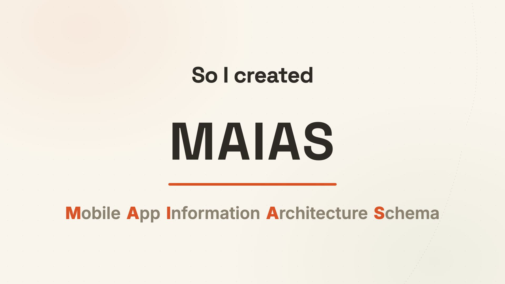
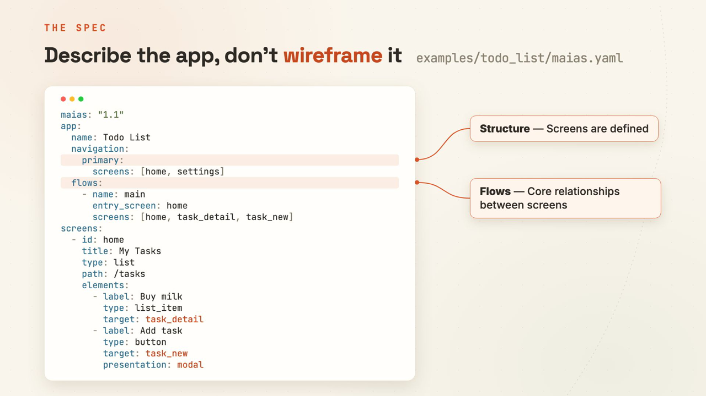
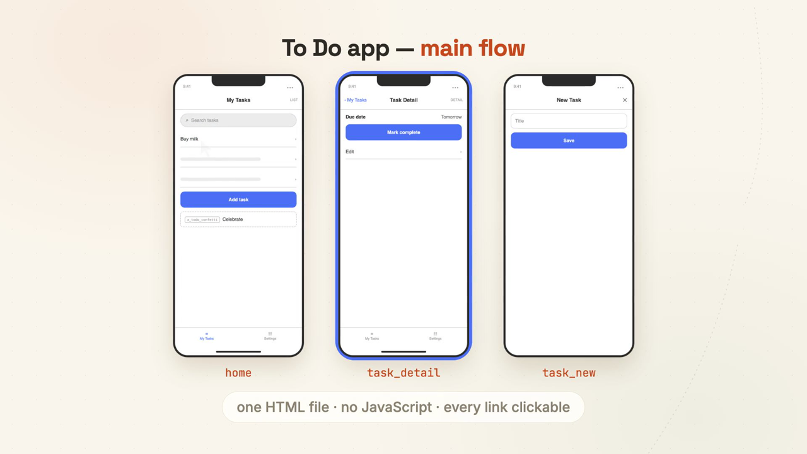

# MAIAS — describe an app flow, get an IA you can trust

**MAIAS** (Mobile App Information Architecture Schema) is an open standard for describing an app's information architecture — screens, navigation, flows, states and data — in one document that humans can read and agents can operate.

This repo is the short tour. The spec, tooling and source live at **[MAIAS-project/maias](https://github.com/MAIAS-project/maias)**.

<!-- VIDEO SLOT 1 — replace the image line below with the GitHub attachment URL for videos/maias-story.mp4 -->
https://github.com/user-attachments/assets/d9c17bf6-de1c-46be-8d15-9381a7a91e23
<!-- [](videos/maias-story.mp4) -->

## Why I built it

I'm a product manager, ex-developer and compulsive builder. I needed a way to describe an app's information architecture to an agent, and couldn't find anything that fit.

When you ask an agent to "build me a todo app with due dates", it builds one. But who decided how it should actually work? The structure — which screens exist, how you move between them, what happens when a list is empty — ends up implied by the code, where nobody reviewed it.

So I created MAIAS, so my agents and I can build apps together with a structure we can both work with.

## One document

```yaml
maias: "0.3"
app:
  name: Todo List
  navigation:
    primary:
      screens: [home, settings]     # ← the tab bar, derived, not drawn
  flows:
    - name: main
      entry_screen: home
      screens: [home, task_detail, task_new]
screens:
  - id: home
    title: My Tasks
    type: list
    path: /tasks
    description: All tasks, newest first.
    elements:
      - label: Buy milk
        type: list_item
        target: task_detail          # ← references are validated, renames cascade
```

You define it. Agents create it. Everyone uses it.

<!-- VIDEO SLOT 2 — replace the image line below with the GitHub attachment URL for videos/maias-intro.mp4 -->
[](videos/maias-intro.mp4)

## The plugin: describe → create → review → edit → wireframe

In Claude Code, one install gives you four skills and the MAIAS MCP server:

```
/plugin marketplace add MAIAS-project/maias-plugin
/plugin install maias@maias
```

Then just ask: *"create an IA for a recipe app"*.

| Step | What happens |
|---|---|
| **describe** | Plain language in |
| **create** | A valid MAIAS document out |
| **review** | Missing states, confusing navigation and confusing UX get flagged |
| **edit** | Renames and restructures keep every reference intact |
| **wireframe** | One HTML file, no JavaScript, every link clickable — including empty, loading and error states |

<!-- VIDEO SLOT 3 — replace the image line below with the GitHub attachment URL for videos/maias-plugin-demo.mp4 -->
[](videos/maias-plugin-demo.mp4)

## Try it without installing anything

```sh
# validate a document — schema + semantic lint, with line numbers
npx -y @maias/cli validate my-app.maias.yaml

# rename a screen — cascades to flows, navigation and every target
npx -y @maias/cli rename my-app.maias.yaml old_screen new_screen
```

Not using Claude Code? The MCP server works in any MCP client: `npx -y @maias/mcp`.

## Where everything lives

| | |
|---|---|
| **Spec, schema, tooling, examples** | [MAIAS-project/maias](https://github.com/MAIAS-project/maias) |
| **Agent reference (one context window)** | [llms.txt](https://github.com/MAIAS-project/maias/blob/main/docs/spec/llms.txt) |
| **Claude Code plugin** | [MAIAS-project/maias-plugin](https://github.com/MAIAS-project/maias-plugin) |
| **npm** | [`@maias/cli`](https://www.npmjs.com/package/@maias/cli) · [`@maias/core`](https://www.npmjs.com/package/@maias/core) · [`@maias/mcp`](https://www.npmjs.com/package/@maias/mcp) |
| **MCP registry** | `io.github.MAIAS-project/maias` |

Issues, ideas and pull requests belong on [MAIAS-project/maias](https://github.com/MAIAS-project/maias/issues) — if it's useful to you, a star there helps other people find it.

## Status

Pre-release. MAIAS is pre-1.0, so the format and tooling may change in breaking ways between 0.x versions. It is free and open under Apache-2.0.

The videos were recorded in July 2026 and show an earlier version number in the sample document; the current spec is v0.3.

---

Built by [@TechPdM](https://github.com/TechPdM).
